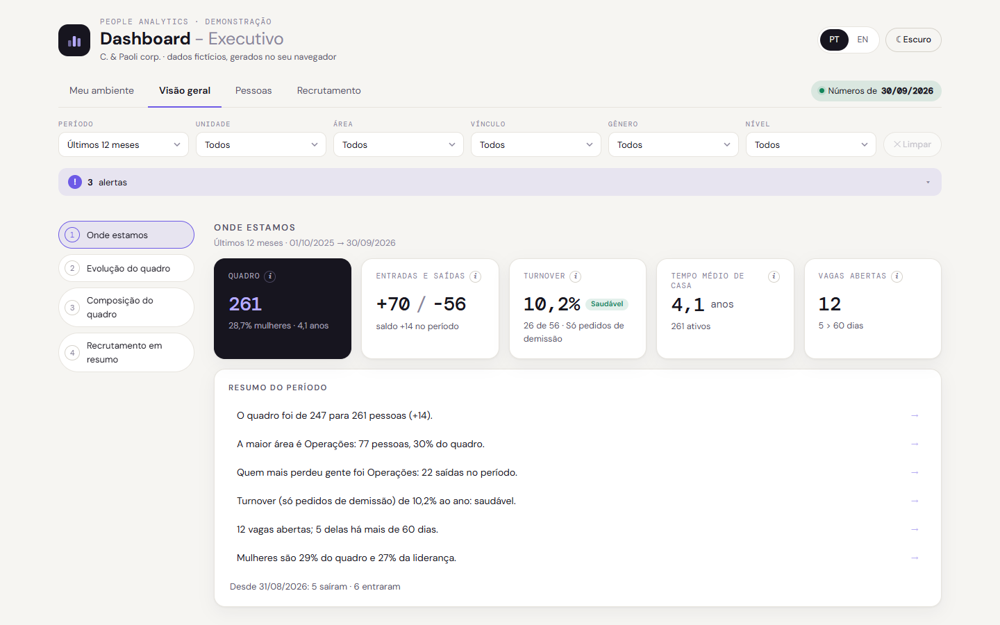
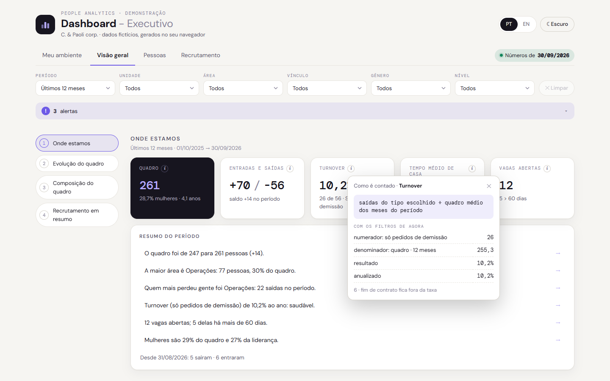
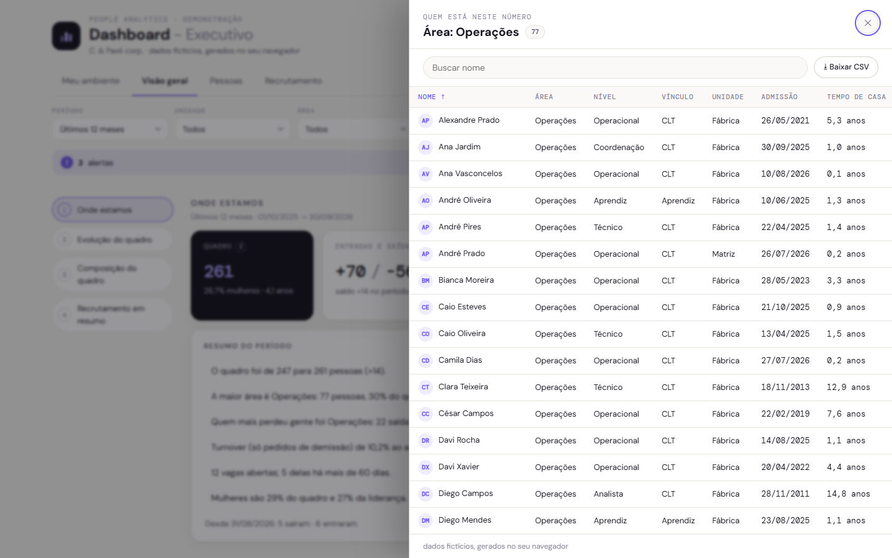
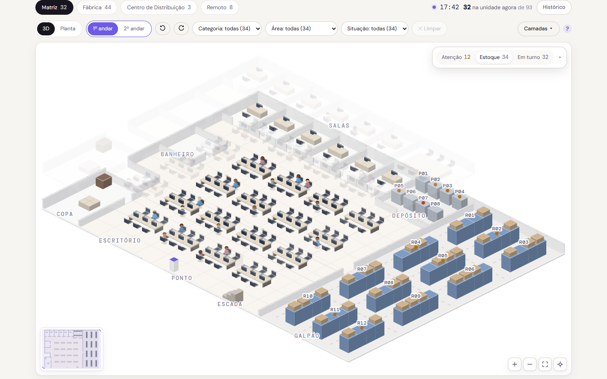
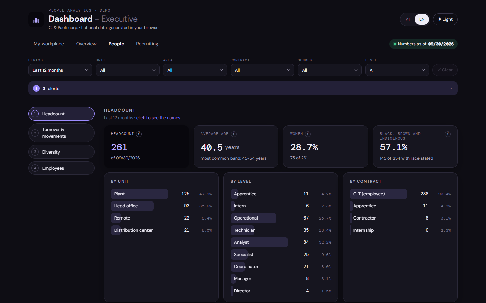
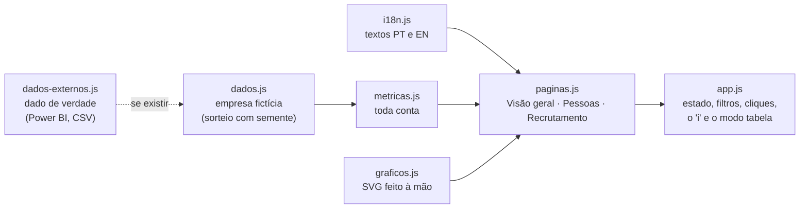

# Dashboard - Executivo · People Analytics

**Demo de People Analytics com uma empresa fictícia.** É o tipo de painel que eu construí no trabalho para a liderança, refeito do zero com dados gerados no navegador. Português e inglês, tema claro e escuro, sem build e sem biblioteca. Também roda **dentro do Power BI**.

[](https://fernandotrecruiter.github.io/people-analytics-dashboard/)
[](https://fernandotrecruiter.github.io/)



## Por que existe

A liderança precisava responder sozinha as perguntas do dia a dia (quantos somos, quem entrou, quem saiu e por quê, como vão as vagas) sem esperar uma planilha. Foi uma solução simples, porém eficiente: um arquivo que abre em qualquer navegador. Os padrões que fazem a diferença:

| Padrão | Por quê |
|---|---|
| Todo número tem um **"i"** com a conta por trás, já com os filtros da tela | Número sem explicação vira discussão sobre o número |
| **Modo tabela**: clicar numa barra, num mês ou num número abre a lista de quem está ali (nomes fictícios), com busca, ordem e CSV | A pergunta seguinte é sempre "quem são?" |
| **Quem conta como saída** é uma escolha na tela; fim de contrato nunca entra na taxa | Turnover significa coisas diferentes para pessoas diferentes |
| **Resumo do período** em frases, cada uma levando aos nomes | Quem tem 30 segundos lê a frase, não o gráfico |
| Alertas só quando há ação, com botão **Ir** | Alerta que não leva a lugar nenhum vira ruído |
| Uma anatomia só para todo cartão e toda lista "por X" (barra **atrás** do rótulo) | Quem passa o olho não reaprende a ler a cada cartão |
| **Meu ambiente** (a primeira aba): o mapa 3D de cada unidade com quem bateu o ponto, sempre ao vivo (a hora de quem abre, no dia de exemplo), uma janela dentro do mapa que recolhe, com as abas Atenção, Estoque e Em turno (quem está e onde), o Histórico do dia, a Matriz em 2 andares, o pátio da Fábrica com os recebimentos e o clique na pessoa que aproxima a câmera | Mostra presença e estoque sem planilha; a posição no mapa é ilustrativa, e cadastro errado aparece errado |

| O "i": a conta por trás do número | Modo tabela: quem está na barra |
|---|---|
|  |  |



Em inglês e no tema escuro, a aba Pessoas:



## Como funciona



- **`js/dados.js`** sorteia cerca de 350 pessoas e 130 vagas em 21 meses com semente fixa: toda visita mostra os mesmos números.
- **`js/dados-externos.js`** é o **esquema** para dado de verdade: se a página tiver `window.DADOS_BRUTOS`, o dashboard usa esses dados no lugar da empresa fictícia (formato documentado no topo do arquivo).
- **`js/metricas.js`** é o único lugar que calcula; a tela, o "i" e o modo tabela leem o mesmo objeto.
- **`js/graficos.js`** desenha em SVG e HTML: linha com entradas e saídas, barras de entradas e saídas por mês, barras mensais com cor pelo limite, segmentos empilhados e funil.

## Dentro do Power BI

A pasta [`powerbi/`](powerbi/LEIA-ME.md) tem o caminho completo: `gera_powerbi.py` junta tudo num HTML único sem internet e escreve a medida DAX (`MedidaDashboard.dax`) que transforma as suas tabelas em JSON com `CONCATENATEX`, no mesmo esquema do organograma em DAX. Vêm junto CSVs de exemplo para testar de ponta a ponta. Prova feita aqui: lendo os CSVs pelo caminho do Power BI, os 13 indicadores principais dão exatamente os mesmos números da demo.

## Rodar

Abra o `index.html` em qualquer navegador. Os prints deste README saem de `python ferramentas/prints_readme.py`.

Abre no Meu ambiente. Parâmetros de endereço: `lang=en` · `tema=escuro` · `aba=geral|pessoas|rs|ambiente` · `embed=1` (usado dentro do portfólio).

## Testes

Um navegador de verdade, pilotado pelo protocolo de DevTools, clica pelo dashboard e confere 11 coisas: nenhum erro de JavaScript em todas as abas, idiomas e temas; o número do cartão é o número calculado; o "i" abre a conta; Limpar devolve o número de antes; a busca mantém o foco; "por área" soma o quadro; abas sem rolagem e filtros do mesmo tamanho; o trilho acende a última seção no fim da página; o modo tabela abre com o mesmo número de nomes da barra; e nada vaza da tela num celular de 390 px.

A aba Meu ambiente tem bateria própria (36 itens): bonecos na tela = pessoas com ponto aberto, ninguém atravessa parede nem entra em área (ou andar) que não é a sua, filtros com a contagem certa, avisos que levam à prateleira, histórico e recebimentos conferidos com a regra, clique na pessoa, mouse que congela a pessoa, arrastar o mapa sem selecionar texto, idioma de todas as abas (português sem inglês, inglês sem português) e celular.

```bash
pip install websocket-client
python tests/teste_dashboard.py
python tests/teste_ambiente.py
```

Precisa de Edge ou Chrome (ou defina `NAVEGADOR=/caminho/do/navegador`).

## Licença

MIT. Feito por [Fernando Paoli](https://github.com/FernandoTRecruiter) com o Claude Code como par de trabalho.

---

**English summary.** A People Analytics demo with a fictional company: an executive dashboard where every number explains its math, a table mode with the (fictional) names behind every bar, a workplace map tab and a Power BI mode (single HTML + DAX measure, see `powerbi/`). No build, no libraries, PT/EN, light/dark, and an automated browser test battery.
