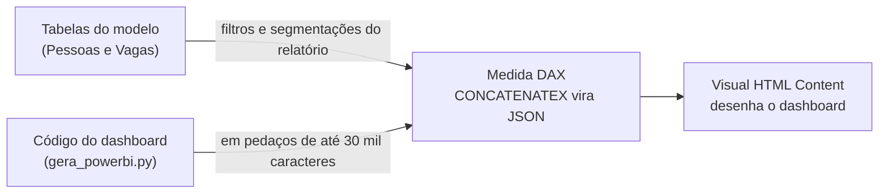

# O dashboard dentro do Power BI

O mesmo dashboard, rodando dentro de um visual **HTML Content** do Power BI e lendo as tabelas do seu modelo. É o mesmo caminho do [organograma em DAX](https://github.com/FernandoTRecruiter/PowerBI.Circular.Organizational.Structure): uma medida monta o HTML inteiro e o visual desenha.

## Como funciona



1. O `gera_powerbi.py` junta todo o CSS e JS do dashboard num HTML só, sem internet, e divide em pedaços (o DAX não aceita um texto de mais de ~32 mil caracteres).
2. A medida `MedidaDashboard.dax` transforma as linhas das suas tabelas em JSON com `CONCATENATEX` e coloca em `window.DADOS_BRUTOS`.
3. O dashboard vê que chegou dado de verdade e usa ele no lugar da empresa fictícia (a regra está em `js/dados-externos.js`).
4. Segmentação e filtro do relatório filtram a tabela **antes** da medida: o dashboard recebe só as linhas filtradas. RLS (segurança por linha) vale do mesmo jeito.

## O esquema: o que as tabelas precisam ter

**Pessoas**: uma linha por pessoa, com **ativos e desligados dos últimos 21 meses** (sem desligados não existe turnover).

| Coluna no modelo (troque pelo seu nome) | Campo | Formato | Obrigatória |
|---|---|---|---|
| `[Matricula]` | id | texto | sim |
| `[Nome]` | nome | texto | sim |
| `[Admissao]` | admissao | data | sim |
| `[Desligamento]` | desligamento | data ou vazio | sim |
| `[MotivoDesligamento]` | motivo | texto com "pedido", "demissão", "fim de contrato" ou outro | sim |
| `[Area]`, `[Unidade]`, `[Nivel]` | area, unidade, nivel | texto livre (vira a lista dos filtros) | sim |
| `[Vinculo]` | vinculo | "CLT", "PJ", "Estágio", "Aprendiz", "Temporário" ou outro texto | sim |
| `[Genero]` | genero | "F"/"Feminino", "M"/"Masculino"; outro = não informado | sim |
| `[Raca]` | raca | "Branca", "Parda", "Preta", "Amarela", "Indígena"; outro = não informado | sim |
| `[Nascimento]` | nascimento | data | sim |

Opcionais (acrescente na medida se tiver): `nivel_ordem` (número para ordenar os níveis, 0 = mais júnior) e `lider` ("S"/"N"). Sem eles, a ordem e a liderança saem do nome do nível (Coordenação, Gerência e Diretoria contam como liderança).

**Vagas** (opcional; sem ela, troque o bloco `_vagas` por `VAR _vagas = "[]"`):

| Coluna | Campo | Formato |
|---|---|---|
| `[Vaga]` | id | texto |
| `[Area]`, `[Unidade]`, `[Nivel]` | area, unidade, nivel | texto |
| `[Abertura]`, `[Fechamento]` | abertura, fechamento | data (fechamento vazio = aberta) |
| `[Status]` | status | "aberta", "fechada" (com contratação) ou "cancelada" |
| `[Etapa]` | etapa | "triagem", "entrevistas" ou "oferta" |
| `[Inscritos]`, `[Triagem]`, `[Entrevistas]`, `[Ofertas]`, `[Contratados]` | números do funil | número |

## Passo a passo

1. **Instale o visual**: Power BI Desktop > Visualizações > "Obter mais visuais" > procure **HTML Content** > Adicionar. É o mesmo visual do organograma, que executa o JavaScript do HTML.
2. **(Para testar antes)** Importe `exemplo_pessoas.csv` e `exemplo_vagas.csv` (separador `;`, UTF-8) como tabelas chamadas `Pessoas` e `Vagas`. São a empresa fictícia da demo, já no formato do esquema.
3. **Crie a medida**: Modelagem > Nova medida > apague o texto > cole o conteúdo de `MedidaDashboard.dax` > Enter.
4. **Troque os nomes**: no topo da medida, troque `'Pessoas'`, `'Vagas'` e cada `[Coluna]` pelos nomes do seu modelo. Não mexa nos blocos `_a1`, `_d1`... (são o código do dashboard).
5. **Coloque na tela**: arraste o visual HTML Content, ponha a medida `DashboardHTML` em "Values" e estique o visual (recomendado 1280 x 900 ou mais).
6. **Confira**: com os CSVs de exemplo, o quadro tem de dar **261** pessoas e o turnover (só pedidos de demissão, últimos 12 meses) **10,2%**, os mesmos números da demo.

## Quando o código do dashboard mudar

```
python powerbi/gera_powerbi.py
```
Depois cole a medida de novo (passo 3) e refaça só o passo 4.

## Limites e cuidados

- **Clique não filtra o relatório**: o que você clica dentro do HTML (abas, modo tabela) não filtra os outros visuais do Power BI. O caminho contrário funciona: segmentações filtram o dashboard.
- **Volume**: centenas a poucos milhares de pessoas rodam bem. Muito mais que isso deixa o visual lento, porque tudo vira texto dentro da medida.
- **Sem internet**: a versão do Power BI usa as fontes do sistema (o desenho fica igual, a letra muda um pouco).
- **"Meu ambiente" não aparece** com dado real: o mapa usa ponto e inventário simulados. Por isso o `gera_powerbi.py` nem coloca os arquivos dessa aba no HTML único (lista `FORA_DO_POWERBI`), o que economiza pedaços na medida.
- **Privacidade**: tudo o que entra na medida é visível para quem vê o relatório. Não acrescente coluna que o público do relatório não pode ver (salário, documento), e use RLS se cada gestor só pode ver a própria equipe.
- **Não testado dentro do Power BI ainda**: daqui foi provado que o HTML único funciona sem internet e que a leitura dos CSVs dá exatamente os mesmos números da demo (13 indicadores iguais). A primeira rodada no Power BI é com os CSVs de exemplo, conferindo o passo 6.
